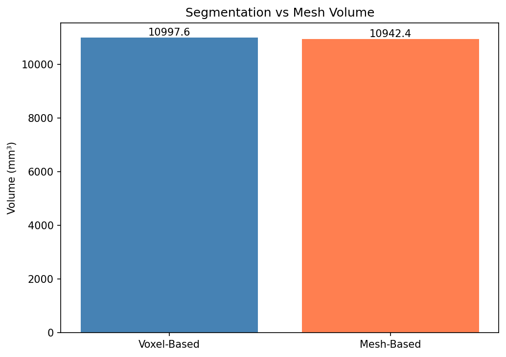

# Medical 3D Visualization & Mesh Analysis

A Python-based project for converting medical image
segmentation masks into interactive 3D surface meshes.

## Project Objectives

- Load medical images and segmentation masks.
- Reconstruct 3D surfaces using Marching Cubes.
- Visualize anatomical structures interactively.
- Compute mesh geometry measurements.
- Export 3D models in STL format.

## Technologies

- Python
- NumPy
- NiBabel
- scikit-image
- Trimesh
- Plotly
- Jupyter Notebook

## Dataset

For dataset licensing and attribution details,
see [DATA_LICENSE.md](DATA_LICENSE.md).

## Project Status

Step 1: Project setup.
## Step 2 — Medical Image Loading and Exploration

In this step, CT images and lymph node segmentation masks
from the HCUCH dataset were loaded using NiBabel.

The workflow includes:

- Loading 3D NIfTI medical images.
- Checking image dimensions and voxel spacing.
- Identifying differences in image orientation.
- Aligning segmentation masks with their corresponding CT images.
- Visualizing CT slices and segmentation overlays.

### Image Alignment

The selected CT and segmentation mask had identical dimensions
and voxel spacing but different orientations.

CT orientation: LAS
Mask orientation: LAI

The mask was aligned with the CT image by reversing its
third axis after verifying the voxel-coordinate transformation.

### Dataset

The HCUCH dataset is used for this project.

The original dataset publication and access information
will be included in the dataset documentation.

### Results

CT images and their corresponding segmentation masks
were successfully loaded, geometrically aligned,
and visualized.
## Step 3 — 3D Mesh Reconstruction

A lymph node segmentation mask from the HCUCH dataset was
converted into a 3D surface mesh using the Marching Cubes algorithm.

### Method

1. Selected a segmented lymph node.
2. Converted the segmentation into a binary 3D mask.
3. Applied Marching Cubes with the original voxel spacing.
4. Generated a triangular surface mesh.
5. Visualized the reconstructed model using Plotly.
6. Exported the mesh in STL format.
7. Performed a visual comparison using 3D Slicer.

### Mesh Results

| Metric | Value |
|---|---|
| Vertices | 5,886 |
| Faces | 11,768 |
| Bounding Box X | 34.94 mm |
| Bounding Box Y | 35.61 mm |
| Bounding Box Z | 30.00 mm |
| Watertight | True |

The reported dimensions represent the mesh bounding box,
not clinical lymph node diameter measurements.

### 3D Slicer Comparison

The segmentation was also inspected in 3D Slicer to
visually compare the reconstructed anatomical structure.

Quantitative agreement between the Python-generated mesh
and 3D Slicer measurements has not yet been established.
## Step 4 — Interactive 3D Visualization

An interactive 3D visualization was developed using
Plotly and Trimesh.

### Features

- Loading reconstructed STL meshes.
- Interactive rotation and zoom.
- Height-based color mapping.
- Visualization of 3D geometry in millimeters.
- Exporting interactive visualizations as HTML.

### Color Mapping

The Z-coordinate of each mesh vertex was mapped to a
continuous color scale.

This demonstrates a basic scientific visualization
technique for representing numerical information
on a 3D anatomical surface.

The colors represent geometric height only and
do not indicate tissue properties or clinical findings.
## Step 5 — Mesh Analysis and Quantitative Evaluation

The reconstructed 3D mesh was analyzed to calculate
its geometric properties.

### Measurements

- Mesh volume (mm³)
- Surface area (mm²)
- Bounding box dimensions (mm)
- Watertightness
- Voxel-based segmentation volume

### Volume Comparison

Two volume estimation methods were compared:

1. Voxel-based volume calculated from the segmentation mask.
2. Mesh-based volume calculated from the reconstructed surface.

The percentage difference between both measurements
was calculated to investigate the effect of surface
reconstruction on volume estimation.

### Results

Numerical measurements are available in:

`results/mesh_analysis.csv`